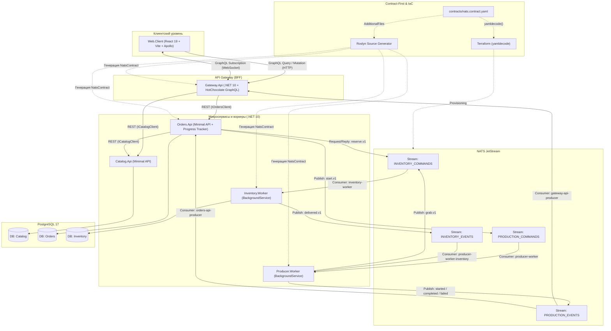
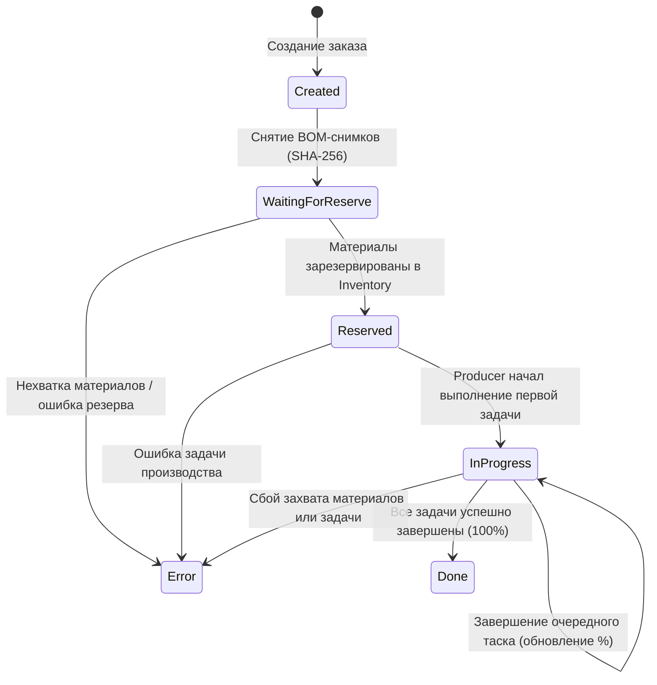
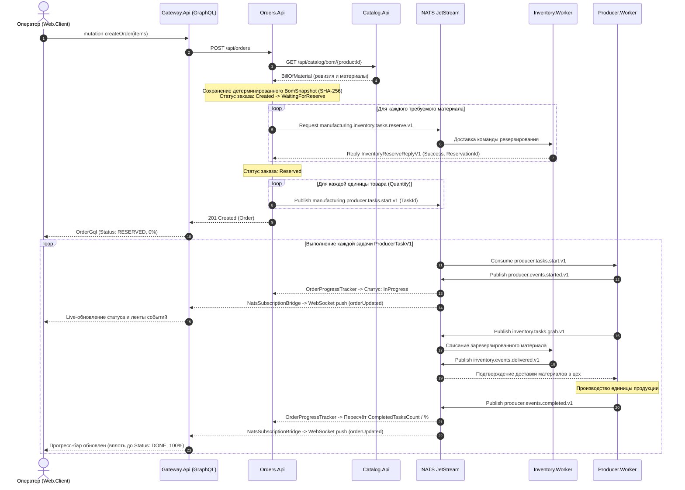

# Manufacturing Platform

Распределённая событийно-ориентированная платформа управления производством на базе **.NET 10**, **NATS JetStream**, **PostgreSQL**, **HotChocolate GraphQL (BFF)** и **React 19**.

---

## Архитектура системы

Платформа построена вокруг подхода **Contract-First** для обмена сообщениями в NATS JetStream и паттерна **Backend-for-Frontend (GraphQL API Gateway)** для клиентского приложения:

- Единый контракт [contracts/nats.contract.yaml](contracts/nats.contract.yaml) используется одновременно:
  1. **Roslyn Incremental Source Generator** (`Manufacturing.Nats.Contracts.Generator`) — на этапе компиляции генерирует строго типизированный C#-класс `NatsContract` со всеми стримами, субъектами и консьюмерами.
  2. **Terraform** ([deploy/terraform/nats](deploy/terraform/nats)) — через встроенную функцию `yamldecode` автоматически разворачивает стримы и durable-консьюмеры в NATS JetStream.



---

## Жизненный цикл заказа и последовательность выполнения

Каждый заказ проходит через детерминированную цепочку состояний. Для каждой единицы продукции в позиции заказа создаётся отдельная производственная задача (`ProducerTaskV1`), что позволяет отслеживать прогресс выполнения заказа с точностью до штуки в реальном времени.

### Диаграмма состояний заказа (`OrderStatus`)



### Диаграмма последовательности (End-to-End Flow)



---

## Структура репозитория

```text
manufacturing-platform/
├── contracts/
│   └── nats.contract.yaml                  # Единый контракт стримов, субъектов и консьюмеров NATS JetStream
├── deploy/
│   ├── nats/init-jetstream.sh              # Инициализация JetStream для Docker Compose
│   ├── postgres/init.sql                   # Инициализация БД Catalog, Orders и Inventory
│   └── terraform/nats/                     # Синхронизация контракта NATS с JetStream через yamldecode
├── src/
│   ├── Catalog.Api/                        # REST API каталога (материалы, продукты, ревизии BOM)
│   ├── Catalog.Api.Client/                 # Типизированный HTTP-клиент для Catalog.Api
│   ├── Catalog.Core/                       # Доменные модели каталога
│   ├── Orders.Api/                         # REST API заказов и фоновый трекер прогресса OrderProgressTracker
│   ├── Orders.Core/                        # Доменные модели заказов и детерминированный BomSnapshot
│   ├── Inventory.Contracts/                # Контракты сообщений склада
│   ├── Inventory.DAL/                      # EF Core контекст и миграции склада
│   ├── Inventory.Worker/                   # Воркер резервирования и отгрузки материалов со склада
│   ├── Producer.Contracts/                 # Контракты производственных задач и событий
│   ├── Producer.Worker/                    # Воркер выполнения производственных задач
│   ├── Manufacturing.Core/                 # Общие модели (Product, Material, BillOfMaterial)
│   ├── Manufacturing.Nats.Contract/        # Проект-носитель сгенерированного NatsContract
│   ├── Gateway.Api/                        # GraphQL API Gateway (HotChocolate 16 + NATS WebSocket Bridge)
│   └── Web.Client/                         # Фронтенд (React 19, Vite, Tailwind CSS v4, Apollo Client)
├── tests/
│   ├── Catalog.Seed.Tests/                 # Тесты генератора и сидера каталога
│   └── Orders.Core.Tests/                  # Юнит-тесты BomSnapshot и расчёта прогресса/статусов заказа
├── tools/
│   ├── Catalog.Seed/                       # CLI-утилита наполнения каталога тестовыми данными
│   └── Manufacturing.Nats.Contracts.Generator/ # Инкрементальный генератор Roslyn для NATS-контракта + тесты
├── docker-compose.yml                      # Полный стек для запуска одной командой
└── ManufacturingPlatform.slnx              # Основной файл решения (.NET + .esproj)
```

---

## Быстрый старт

### Вариант 1: Полный стек в Docker Compose (рекомендуется)

Запускает PostgreSQL, NATS JetStream, автоматическую инициализацию стримов/консьюмеров, накатку миграций EF Core, все микросервисы, воркеры, GraphQL Gateway и фронтенд:

```bash
docker compose up --build
```

После запуска сервисы доступны по адресам:
- **Web UI (Панель управления)**: [http://localhost:5173](http://localhost:5173)
- **GraphQL Gateway & Nitro IDE**: [http://localhost:5150/graphql](http://localhost:5150/graphql)
- **Catalog REST API**: `http://localhost:5142`
- **Orders REST API**: `http://localhost:5139`
- **NATS Monitoring**: `http://localhost:8222`

### Вариант 2: Локальная разработка (из IDE или CLI)

1. Поднимите инфраструктуру (PostgreSQL, NATS и инициализацию стримов):
   ```bash
   docker compose up -d postgres nats nats-init
   ```
   *(Либо примените конфигурацию через Terraform в `deploy/terraform/nats`: `terraform init && terraform apply`).*

2. Соберите решение и запустите тесты:
   ```bash
   dotnet build ManufacturingPlatform.slnx
   dotnet test ManufacturingPlatform.slnx --filter "FullyQualifiedName!~PostgresIntegrationTests"
   ```

3. Запустите фронтенд в режиме разработки (с проксированием `/graphql` и WebSocket на `http://localhost:5150`):
   ```bash
   cd src/Web.Client
   npm install
   npm run dev
   ```
