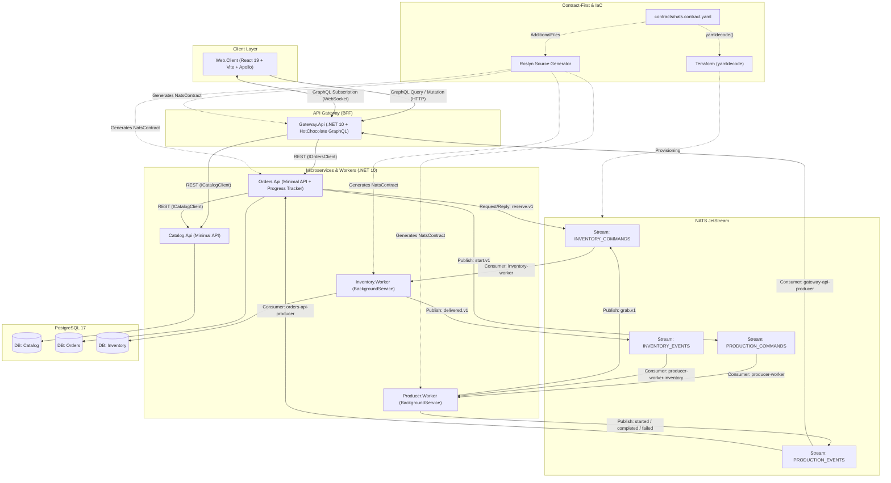
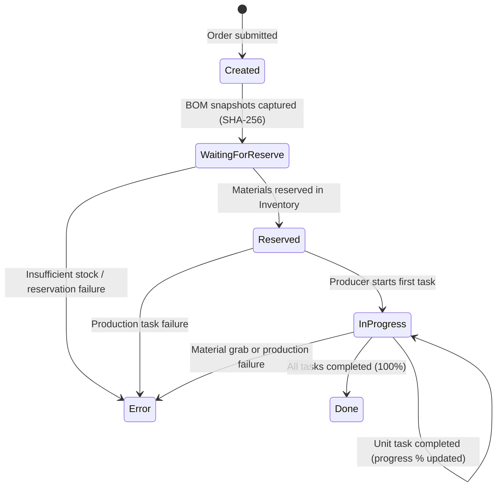
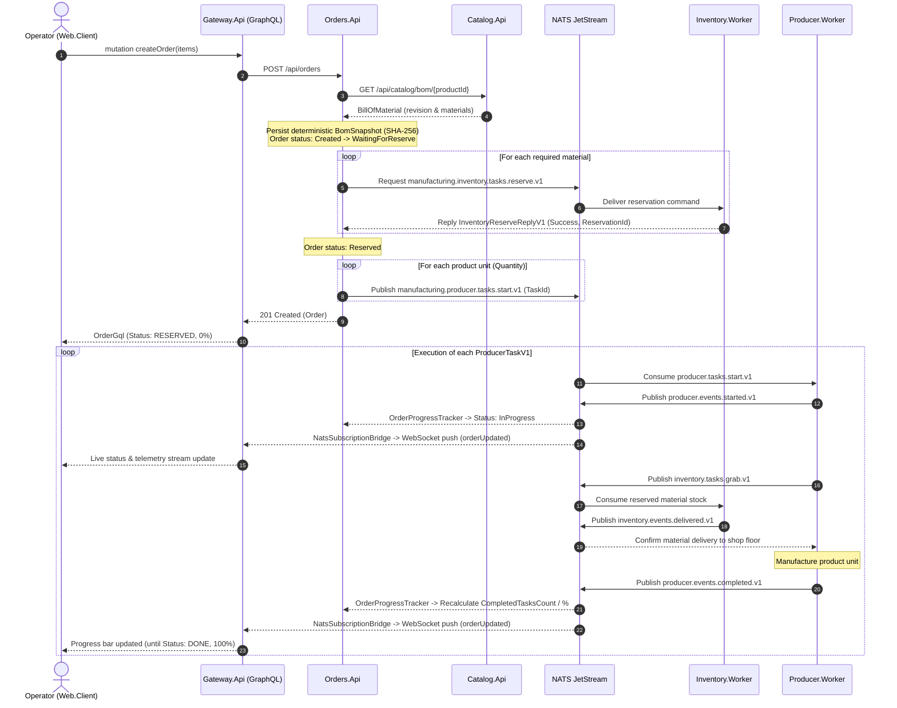

# Manufacturing Platform

A distributed, event-driven manufacturing management platform built with **.NET 10**, **NATS JetStream**, **PostgreSQL**, **HotChocolate GraphQL (BFF)**, and **React 19**.

---

## System Architecture

The platform is built around a **Contract-First** messaging design for NATS JetStream and a **Backend-for-Frontend (GraphQL API Gateway)** pattern for the client application:

- A single source-of-truth contract in [contracts/nats.contract.yaml](contracts/nats.contract.yaml) drives both:
  1. **Roslyn Incremental Source Generator** (`Manufacturing.Nats.Contracts.Generator`) — generates the strongly typed `NatsContract` C# class at compile time with all streams, subjects, and durable consumers.
  2. **Terraform** ([deploy/terraform/nats](deploy/terraform/nats)) — parses the exact same YAML file via the built-in `yamldecode` function to provision streams and durable consumers in NATS JetStream.



---

## Order Lifecycle & Execution Flow

Every order transitions through a deterministic state machine. For each unit of a product in an order line item, a dedicated production task (`ProducerTaskV1`) is dispatched, enabling unit-level real-time progress tracking.

### Order State Machine (`OrderStatus`)



### End-to-End Sequence Diagram



---

## Repository Structure

```text
manufacturing-platform/
├── contracts/
│   └── nats.contract.yaml                  # Single source-of-truth NATS JetStream contract
├── deploy/
│   ├── nats/init-jetstream.sh              # JetStream bootstrap script for Docker Compose
│   ├── postgres/init.sql                   # Initializes Catalog, Orders, and Inventory databases
│   └── terraform/nats/                     # Syncs NATS contract with JetStream via yamldecode
├── src/
│   ├── Catalog.Api/                        # Catalog REST API (materials, products, BOM revisions)
│   ├── Catalog.Api.Client/                 # Strongly typed HTTP client for Catalog.Api
│   ├── Catalog.Core/                       # Catalog domain models
│   ├── Orders.Api/                         # Orders REST API & OrderProgressTracker background service
│   ├── Orders.Core/                        # Order domain models & deterministic BomSnapshot
│   ├── Inventory.Contracts/                # Inventory messaging contracts
│   ├── Inventory.DAL/                      # Inventory EF Core DbContext & migrations
│   ├── Inventory.Worker/                   # Background worker for stock reservations & material grabs
│   ├── Producer.Contracts/                 # Production task & event contracts
│   ├── Producer.Worker/                    # Background worker executing production tasks
│   ├── Manufacturing.Core/                 # Shared domain primitives (Product, Material, BillOfMaterial)
│   ├── Manufacturing.Nats.Contract/        # Host project for the source-generated NatsContract
│   ├── Gateway.Api/                        # GraphQL API Gateway (HotChocolate 16 + NATS WebSocket Bridge)
│   └── Web.Client/                         # Frontend (React 19, Vite, Tailwind CSS v4, Apollo Client)
├── tests/
│   ├── Catalog.Seed.Tests/                 # Catalog seeder & generator tests
│   └── Orders.Core.Tests/                  # Unit tests for BomSnapshot hashing & order progress lifecycle
├── tools/
│   ├── Catalog.Seed/                       # CLI tool for seeding catalog data
│   └── Manufacturing.Nats.Contracts.Generator/ # Roslyn incremental source generator + test suite
├── docker-compose.yml                      # Full-stack Docker Compose setup
└── ManufacturingPlatform.slnx              # Main solution file (.NET + .esproj)
```

---

## Quick Start

### Option 1: Full Stack with Docker Compose (Recommended)

Starts PostgreSQL, NATS JetStream, automatic stream/consumer initialization, EF Core startup migrations, all microservices, background workers, the GraphQL Gateway, and the React frontend:

```bash
docker compose up --build
```

Once started, services are available at:
- **Web UI (Control Center)**: [http://localhost:5173](http://localhost:5173)
- **GraphQL Gateway & Nitro IDE**: [http://localhost:5150/graphql](http://localhost:5150/graphql)
- **Catalog REST API**: `http://localhost:5142`
- **Orders REST API**: `http://localhost:5139`
- **NATS Monitoring**: `http://localhost:8222`

### Option 2: Local Development (IDE or CLI)

1. Start the infrastructure services (PostgreSQL, NATS, and JetStream bootstrap):
   ```bash
   docker compose up -d postgres nats nats-init
   ```
   *(Alternatively, provision NATS via Terraform in `deploy/terraform/nats`: `terraform init && terraform apply`).*

2. Build the solution and run unit tests:
   ```bash
   dotnet build ManufacturingPlatform.slnx
   dotnet test ManufacturingPlatform.slnx --filter "FullyQualifiedName!~PostgresIntegrationTests"
   ```

3. Run the frontend dev server (proxies `/graphql` HTTP and WebSocket traffic to `http://localhost:5150`):
   ```bash
   cd src/Web.Client
   npm install
   npm run dev
   ```
