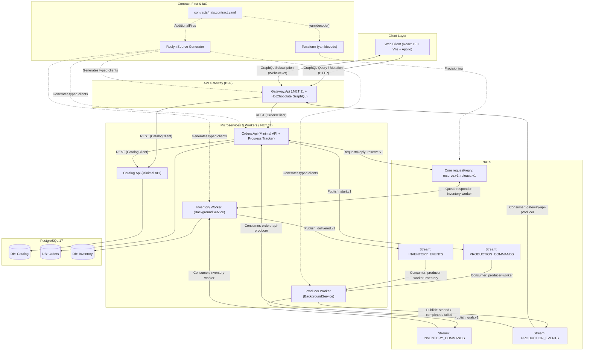
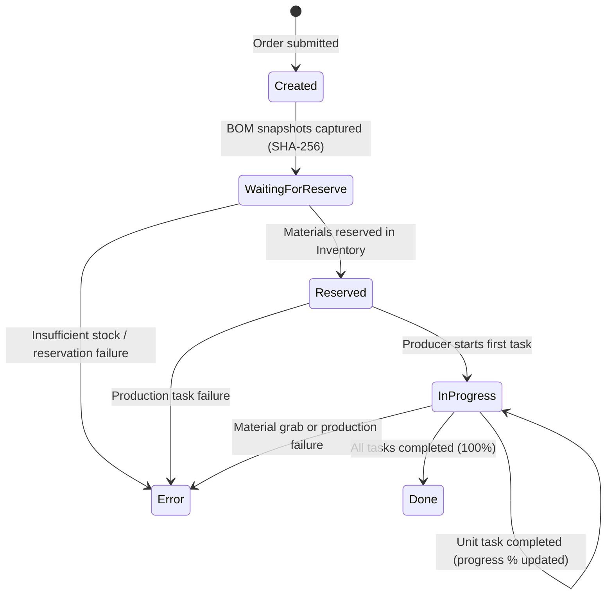
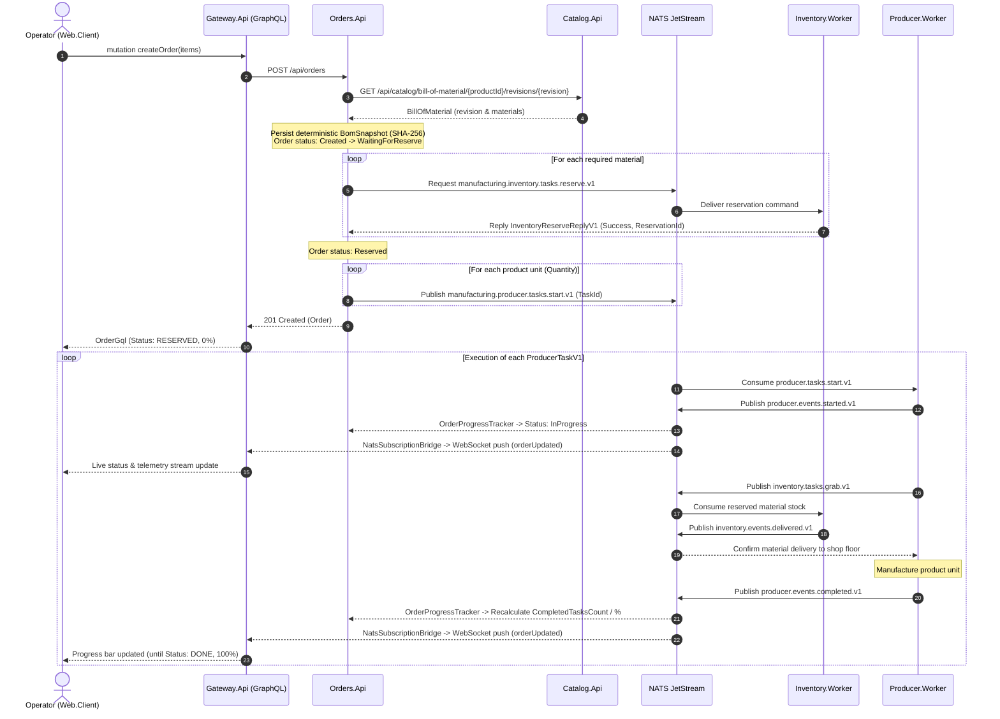

# Manufacturing Platform

A distributed, event-driven manufacturing management platform built with **.NET 11**, **NATS JetStream**, **PostgreSQL**, **HotChocolate GraphQL (BFF)**, and **React 19**.

---

## System Architecture

The platform is built around **Contract-First** designs for NATS JetStream and the internal JSON APIs, and a **Backend-for-Frontend (GraphQL API Gateway)** pattern for the client application:

- The messaging contract in [contracts/nats.contract.yaml](contracts/nats.contract.yaml) binds each subject to its DTO and transport and drives both:
  1. **Roslyn Incremental Source Generator** (`Manufacturing.Nats.Contracts.Generator`) — generates `ProducerNatsClient`, `InventoryNatsClient`, and topology constants at compile time. Application code sends and reads messages through fixed, typed methods rather than choosing subjects and payload types independently.
  2. **Terraform** ([deploy/terraform/nats](deploy/terraform/nats)) — parses the exact same YAML file via the built-in `yamldecode` function to provision streams and durable consumers in NATS JetStream.
- [contracts/producer-events.tsp](contracts/producer-events.tsp) defines `ProducerEventV1` and `ProducerEventType`. A pinned TypeSpec compiler and a local C# emitter generate the checked-in DTOs directly; no Roslyn intermediary or runtime Node.js dependency is involved. Other payload DTOs remain hand-written. See [generation commands](scripts/README.md#contract-code-generation).
- [contracts/catalog.tsp](contracts/catalog.tsp) and [contracts/orders.tsp](contracts/orders.tsp) define the Catalog and Orders JSON APIs. The same emitter generates their DTO records, typed `CatalogClient`/`OrdersClient`, and server handler interfaces whose ASP.NET Core typed results fix each route's status codes and bodies. Errors are RFC 9457 `application/problem+json`. In Development each API serves its TypeSpec-emitted OpenAPI document at `/openapi/v1.json`.
- Inventory reservation uses Core NATS request/reply with a queue-group responder; production tasks, inventory grabs, and events use JetStream. See [typed client usage and rollout](scripts/README.md#typed-nats-api-clients).



---

## Order Lifecycle & Execution Flow

Every order transitions through a deterministic state machine. For each unit of a product in an order line item, a dedicated production task (`ProducerTaskV1`) is dispatched, enabling unit-level real-time progress tracking.

### Order State Machine (`OrderStatus`)



### End-to-End Sequence Diagram



---

## Repository Structure

```text
manufacturing-platform/
├── contracts/
│   ├── catalog.tsp                         # Catalog JSON API contract (TypeSpec)
│   ├── nats.contract.yaml                  # Single source-of-truth NATS JetStream contract
│   ├── orders.tsp                          # Orders JSON API contract (TypeSpec)
│   └── producer-events.tsp                 # ProducerEventV1 message model (TypeSpec)
├── deploy/
│   ├── postgres/init.sql                   # Initializes Catalog, Orders, and Inventory databases
│   └── terraform/nats/                     # Syncs NATS contract with JetStream via yamldecode
├── src/
│   ├── Catalog.Api/                        # Catalog REST API (materials, products, BOM revisions)
│   ├── Catalog.Contracts/                  # Generated Catalog DTOs and typed CatalogClient
│   ├── Catalog.Core/                       # Catalog domain models
│   ├── Orders.Api/                         # Orders REST API & OrderProgressTracker background service
│   ├── Orders.Contracts/                   # Generated Orders DTOs and typed OrdersClient
│   ├── Orders.Core/                        # Order domain models & deterministic BomSnapshot
│   ├── Inventory.Contracts/                # Inventory messaging contracts
│   ├── Inventory.DAL/                      # Inventory EF Core DbContext & migrations
│   ├── Inventory.Worker/                   # Background worker for stock reservations & material grabs
│   ├── Producer.Contracts/                 # Production task & event contracts
│   ├── Producer.Worker/                    # Background worker executing production tasks
│   ├── Manufacturing.Core/                 # Shared domain primitives (Product, Material, BillOfMaterial)
│   ├── Manufacturing.Nats.Contract/        # Host project for the source-generated NatsContract
│   ├── Gateway.Api/                        # GraphQL API Gateway (HotChocolate 16 + NATS WebSocket Bridge)
│   └── Web.Client/                         # Frontend (React 19, Vite, Tailwind CSS v4, Apollo Client)
├── tests/
│   ├── Catalog.Seed.Tests/                 # Catalog seeder & generator tests
│   └── Orders.Core.Tests/                  # Unit tests for BomSnapshot hashing & order progress lifecycle
├── tools/
│   ├── Catalog.Seed/                       # CLI tool for seeding catalog data
│   ├── Contracts.Generator/                # TypeSpec → C# emitter (DTOs, HTTP clients/handlers, OpenAPI)
│   └── Manufacturing.Nats.Contracts.Generator/ # Roslyn incremental source generator + test suite
├── docker-compose.yml                      # Full-stack Docker Compose setup
└── ManufacturingPlatform.slnx              # Main solution file (.NET + .esproj)
```

---

## Quick Start

### Option 1: Full Stack with Docker Compose (Recommended)

Requires Terraform 1.7+ in addition to Docker Compose. Provisioning is explicit:
Terraform owns the NATS topology; containers do not create streams or consumers.

1. Start PostgreSQL and NATS:
   ```bash
   docker compose up -d postgres nats
   ```
2. Run the [local Terraform provisioning steps](scripts/README.md#nats-terraform-provisioning).
   Existing Terraform state must be migrated first as described there.
3. Only after a successful apply, start the applications:
   ```bash
   docker compose up --build
   ```

Once started, services are available at:
- **Web UI (Control Center)**: [http://localhost:5173](http://localhost:5173)
- **GraphQL Gateway & Nitro IDE**: [http://localhost:5150/graphql](http://localhost:5150/graphql)
- **Catalog REST API**: `http://localhost:5142`
- **Orders REST API**: `http://localhost:5139`
- **NATS Monitoring**: `http://localhost:18222`
- **PostgreSQL / NATS client** (host side): `localhost:15432` / `nats://localhost:14222`. The non-default
  ports avoid silently reaching another local or Kubernetes-forwarded server on 5432/4222.

### Option 2: Local Development (IDE or CLI)

1. Start the infrastructure and provision NATS:
   ```bash
   docker compose up -d postgres nats
   ```
   Follow the [Terraform environment/state workflow](scripts/README.md#nats-terraform-provisioning)
   before launching workers or APIs. Compose waits for NATS to start, not for
   Terraform; provisioning is an operator/CI step.

2. Build the solution and run unit tests:
   ```bash
   dotnet build ManufacturingPlatform.slnx
   dotnet test ManufacturingPlatform.slnx --filter "FullyQualifiedName!~PostgresIntegrationTests"
   ```
   Inventory stock tests (reserve/release against PostgreSQL) are skipped unless
   `INVENTORY_TEST_CONNECTION` points at a disposable server with `CREATEDB`; each run
   creates and drops an `inventory_test_*` database:
   ```bash
   INVENTORY_TEST_CONNECTION='Host=localhost;Port=15432;Database=postgres;Username=postgres;Password=postgres' \
     dotnet test tests/Inventory.Worker.Tests
   ```

3. Run the frontend dev server (proxies `/graphql` HTTP and WebSocket traffic to `http://localhost:5150`):
   ```bash
   cd src/Web.Client
   npm install
   npm run dev
   ```
